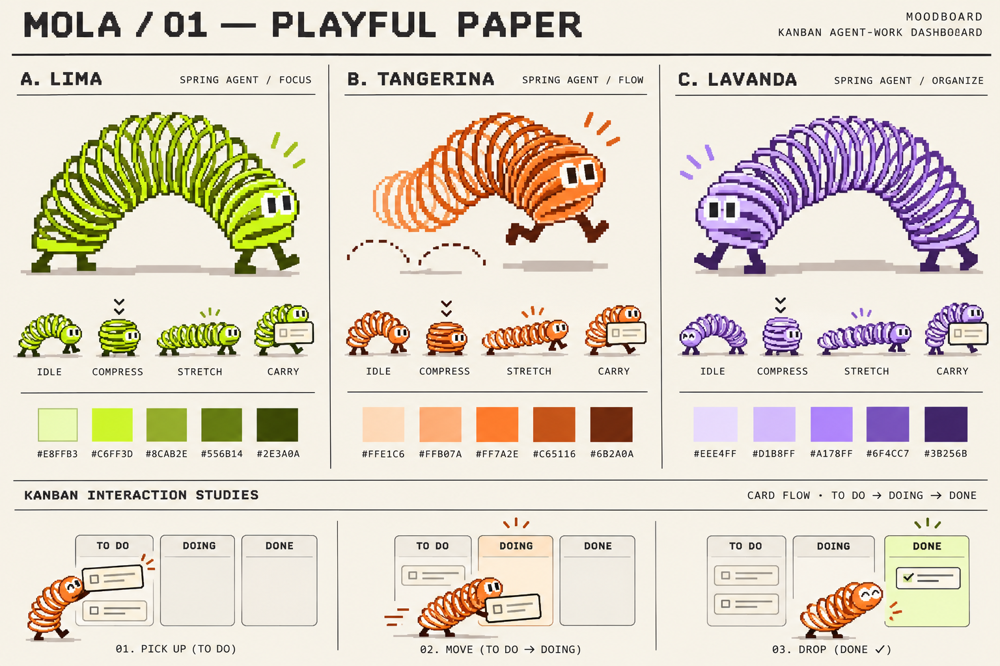
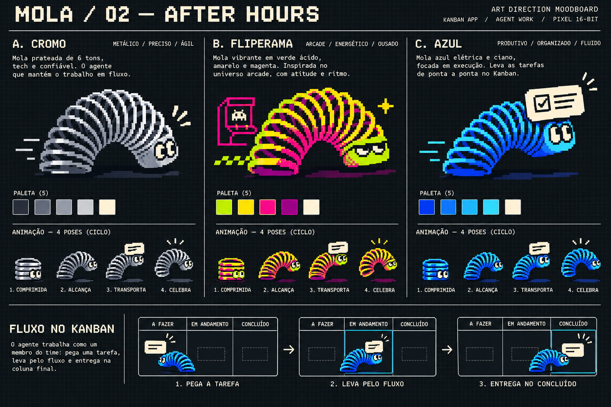

# Mola · ResolveQA Front

Frontend experimental para acompanhar trabalho em um Kanban com uma mola de brinquedo em pixel art. A mola transporta os cards entre **A fazer**, **Em andamento** e **Concluído**.

## Rodar

Requer Node.js 22.13+ e npm.

```sh
npm ci
npm run dev
```

Abra http://localhost:5173. Para gerar a versão de produção:

```sh
npm run build
npm run start
```

## O que explorar

- Seis personagens/paletas: Lima, Tangerina, Lavanda, Cromo, Fliperama e Azul.
- Avanço manual, reprodução automática pausável e arrastar/soltar cards.
- Criação de tarefas, filtro por agente, detalhes e registro de eventos.
- Estado salvo no navegador, importação e exportação de snapshots JSON.
- Layout responsivo, navegação por teclado e redução de movimento conforme a preferência do sistema.
- Duas pranchas de direção visual com variantes e estudos de animação.

O quadro inicia em **modo demonstração**. Os nomes dos agentes e as tarefas iniciais são ilustrativos. Os eventos registram interações desta sessão; não há conexão ativa ao GitHub, ao Maestri ou a um serviço de agentes. Um snapshot importado continua sendo uma cópia local dos dados.

## Direção visual

A referência de movimento é a landing da [Keytotwo](https://keytotwo.com.br/). A identidade da Mola, o personagem procedural e as pranchas são próprios.

| Prancha | Explorações |
| --- | --- |
| [Playful Paper](public/moodboards/mola-paper.png) | Lima, Tangerina, Lavanda |
| [After Hours](public/moodboards/mola-night.png) | Cromo, Fliperama, Azul |




As imagens foram geradas para esta exploração. O personagem da interface é desenhado por código e anima sem depender de recortes das pranchas.

## Fonte

- `app/page.tsx`: estado do quadro e interações.
- `app/globals.css`: composição, responsividade e movimento.
- `components/mola/`: personagem procedural e variantes.
- `public/moodboards/`: pranchas PNG em resolução original.
- [Contrato de snapshot](docs/snapshots.md): formato de intercâmbio local.
- [Direção visual](docs/art-direction.md): decisões e contexto.

Implementado com React, TypeScript e Vinext/Vite. O starter inclui a configuração de publicação privada pelo Sites; não há credenciais de GitHub no cliente.
