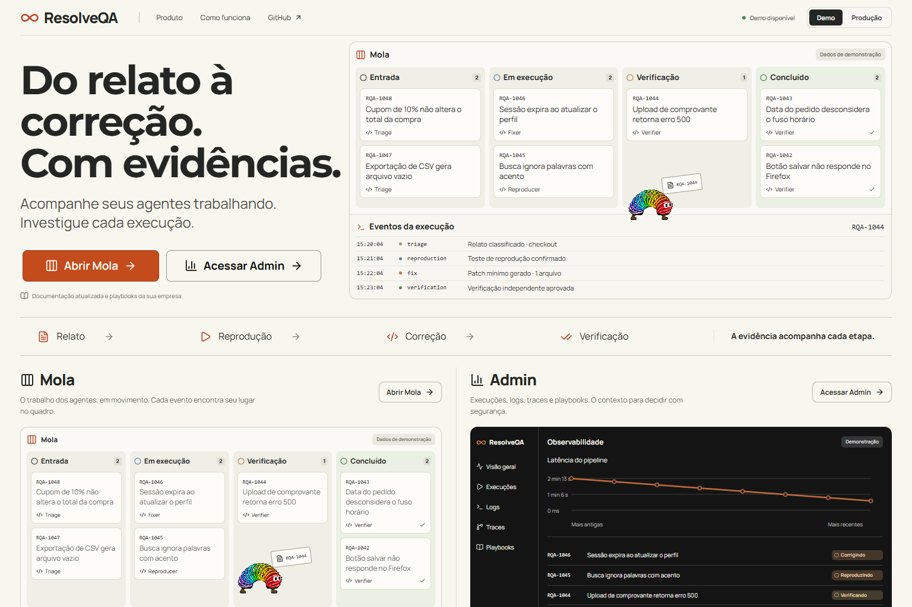
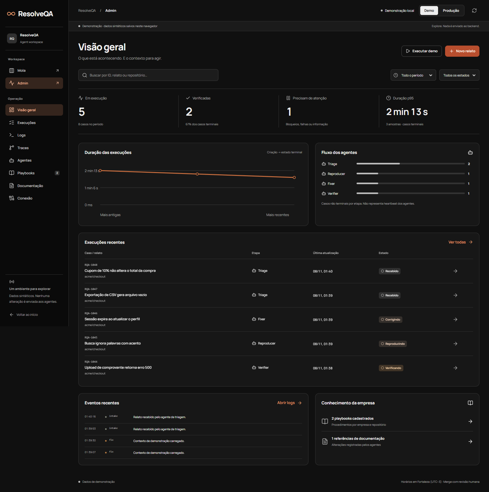
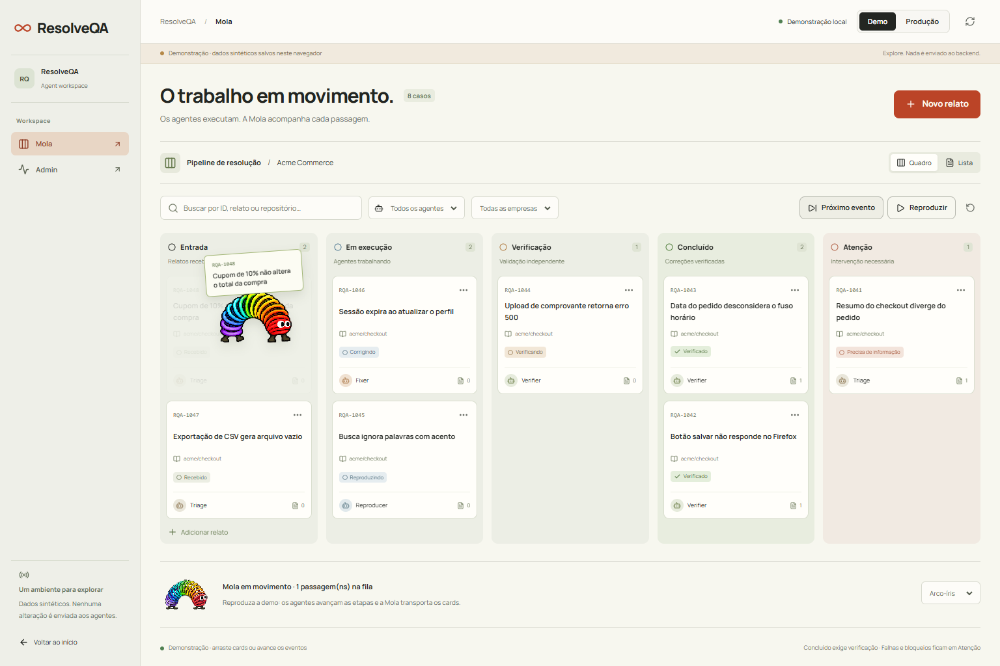

# Evidências — ResolveQA workspace

Validação local em 08/11/2026, com Chrome em desktop **1536×1024** e celular **390×844**. A branch foi reaplicada sobre `main` em `00a6214`, preservando as novas poses e o transporte Slinky do PR #5.

## Resultado

| Verificação | Resultado |
|---|---|
| `npm test` | 10 testes de contratos, estados, evidências, duplicação, sequência e percentis |
| `npx tsc --noEmit` | Passou |
| `npm run lint` | Sem erros; 2 avisos herdados em `atlas.ts` e no smoke histórico de artwork |
| `npm run build` | Passou, com `/`, `/admin` e `/quadro` |
| `npm run test:browser` | 20 verificações, sem erros de página |
| `npm run test:stream` | 6 verificações HTTP/SSE locais, sem erros de página |

Os testes do navegador verificam a copy, os acessos diretos, o painel Admin preto com contraste de títulos ≥7:1 e botões ≥4,5:1, logs, waterfall, CRUD/persistência de playbooks, documentação, ausência de overflow da página no celular, rolagem interna do Kanban, criação/detalhes de casos, transporte da Mola, troca de ambientes e recuperação de armazenamento inválido.

O serviço HTTP/SSE controlado verifica conexão, transições, duplicação de eventos, descoberta de casos criados por agentes remotos, referências de evidência e falha/desconexão sem dados fictícios. Resultados completos: [browser](evidence/functional-checks.json) e [SSE](evidence/stream-checks.json).

## Capturas

| Superfície | Desktop | Celular |
|---|---|---|
| Landing | [Página](evidence/desktop.png) · [primeiro viewport](evidence/desktop-viewport.png) | [Página](evidence/mobile.png) |
| Admin preto | [Painel](evidence/admin-desktop.png) | [Painel](evidence/admin-mobile.png) |
| Mola | [Quadro](evidence/board-desktop.png) · [transporte em execução](evidence/board-motion.png) | [Quadro](evidence/board-mobile.png) |

Outras telas: [logs](evidence/logs-desktop.png), [traces](evidence/traces-desktop.png), [playbooks](evidence/playbooks-desktop.png).

## Revisão visual

A primeira referência foi a base aprovada. A copy de documentação/playbooks e o Admin preto são alterações solicitadas depois dos mockups. A revisão independente identificou sete ajustes de contraste, composição, ações, fundo, densidade e documentação do processo; o retorno de revisão marcou os sete como resolvidos (`ship`, restrito aos ajustes avaliados). A comparação mecânica do primeiro viewport atingiu 75,22%, acima do limiar de 72%; não se trata de uma reprodução pixel a pixel da imagem gerada. Conteúdo operacional semântico e o personagem original foram mantidos no código.

## Limites da validação

- O backend do João foi clonado e seus contratos foram auditados. A API existente oferece criação/consulta de casos.
- As verificações de produção usam respostas locais controladas, não uma ativação remota.
- Snapshot, SSE, spans e CRUD de playbooks exigem as extensões descritas em [production-connection.md](production-connection.md).
- O front não autentica administradores, executa agentes, atualiza arquivos de documentação nem faz merge/deploy. Essas operações pertencem ao backend/gateway autorizado.
- Não houve publicação ou merge nesta entrega. O PR contém o código e as evidências para revisão.
